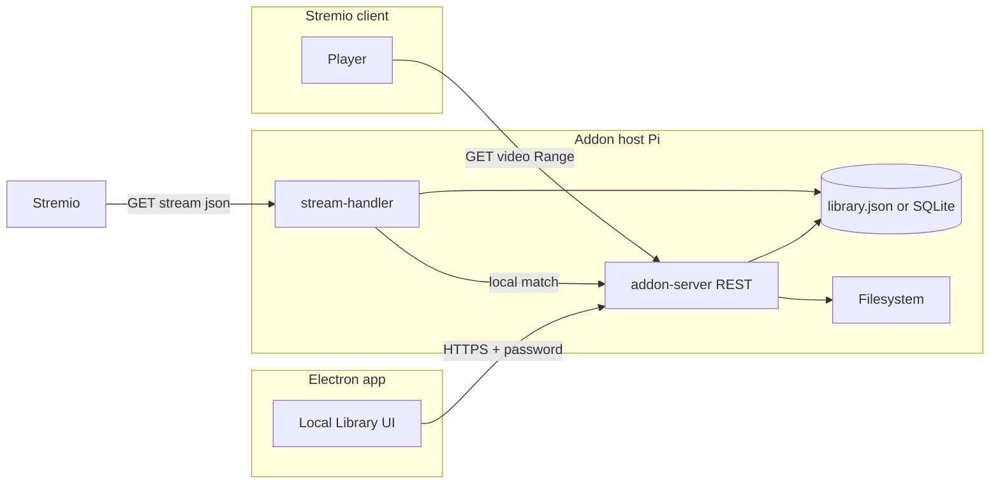

# Local Movies / Series Library — Cross-Package Plan

This document describes how to add **managed local file playback** alongside the existing Real-Debrid torrent pipeline, with **Electron** as the management UI and **addon-server** as the source of truth for paths, metadata, matching, and HTTP serving.

---

## 1. Goals

- Users can **register folders or individual files** on the machine where the addon runs (typically the Raspberry Pi).
- **Per-folder default metadata** and **per-file overrides** (display name, language, resolution, IMDB linkage, etc.).
- **Stremio stream responses** include local entries **in addition to** RD-backed torrent streams (same `stream` resource; no change to how Stremio opens a title if metadata already exists from Cinemeta).
- **Matching** must tolerate filename ≠ API title: use **explicit IDs where possible** and **fuzzy / normalized search** as a fallback.
- **Electron**: a **“Local Movies”** (or **“Local Library”**) area with (a) configured locations and (b) a **browser** to navigate the remote filesystem and add paths.
- **Security**: no path traversal; only paths under allowed roots; same auth model as the rest of the addon (URL password + optional future admin sub-token for write APIs).

Non-goals for v1 (optional later phases):

- Full Stremio **catalog** row (“My library”) with custom search inside Stremio (requires `catalog` + `meta` in manifest).
- Automatic scraping of metadata from filenames only (can be Phase 2).

---

## 2. High-Level Architecture

- **Library store**: single structured file (e.g. `/var/lib/stremio-addon/library.json`) or SQLite under a fixed data dir (env: `LOCAL_LIBRARY_DATA_DIR`). Version field inside file for migrations.
- **Electron** does not mount the Pi disk directly; it calls **addon-server HTTPS APIs** (same base URL / password as today, or a dedicated admin route namespace).
- **Playback**: new route e.g. `GET /:password/local/:token` or signed opaque id streaming file with **Range** support (mirror patterns from existing `/:password/proxy`).

---

## 3. Data Model

### 3.1 Root entries (what the user “adds”)

| Kind   | Stored path | Behavior |
|--------|-------------|----------|
| Folder | Absolute directory | All eligible video files under tree (configurable depth, ignore patterns) inherit **folder default metadata** unless overridden per file. |
| File   | Absolute file path | Single video; metadata attached directly. |

**Eligible extensions** (configurable list): e.g. `.mkv`, `.mp4`, `.webm`, `.avi`, `.m4v`.

### 3.2 Metadata schema (file-level effective record)

Effective metadata = **merge(folderDefaults, fileOverride)** where file wins on each field.

Suggested fields:

| Field | Required | Description |
|-------|----------|-------------|
| `imdbId` | Strongly recommended | e.g. `tt1234567`. Drives exact match to Stremio `stream/movie/tt….json` or `stream/series/tt…:s:e.json`. |
| `type` | Yes | `movie` \| `series` |
| `season` / `episode` | If series | Integers for episode-specific matching. |
| `displayName` | Optional | Shown in Stremio stream name/title; used in fuzzy matching. |
| `language` | Optional | BCP-47 or free text, e.g. `he`, `he-IL` |
| `resolution` | Optional | e.g. `1080p` (display only unless you use it for sorting) |
| `year` | Optional | Helps disambiguation in fuzzy ranking |
| `aliases` | Optional | string[] extra names for fuzzy match |
| `notes` | Optional | Internal / Electron only |

**Folder-level** `defaultMetadata`: same shape minus per-file-only fields where inappropriate (e.g. series folder might set `type: series`, `imdbId`, but `season`/`episode` often per file).

**Per-file override**: partial object; only set fields that differ from folder default.

### 3.3 Internal indexing

On **every library save** or **explicit “Rebuild index”**:

- Expand folder entries to a list of **file records** (path + effective metadata).
- Build an **in-memory index** (or SQLite FTS) for:
  - **Exact**: `(type, imdbId, season?, episode?)` → list of paths
  - **Fuzzy**: normalized tokens from `displayName`, `filename` (without extension), `aliases`, optional parent folder name

Persist:

- `roots[]` (user-configured folders/files + defaults)
- `fileOverrides` map keyed by **canonical absolute path** or stable **file id** (hash of path)

---

## 4. Matching Logic (stream-handler integration)

When `handleStreamRequest({ type, id })` runs (e.g. `id = tt1234567` or `tt1234567:2:5`):

1. **Parse** Stremio id → `imdbId`, optional `season`/`episode`.
2. **Exact match** against index: all local files whose effective metadata equals that triple.
3. If **no exact match** (or as supplement): **fuzzy pass**:
   - Load **Cinemeta** (or existing metadata step) for `name`, `year`, `released_episodes` context.
   - Score each **candidate** local file (same `type` if possible) using:
     - Levenshtein / Jaro-Winkler on normalized strings (ASCII fold; **Hebrew**: optional library or Unicode normalize NFC)
     - Token overlap between metadata `displayName`, `aliases`, **basename** and Cinemeta `name` (+ episode title for series)
     - Boost if `year` matches
   - Threshold + max N results (e.g. top 3 fuzzy) to avoid noise.

4. For each matched local file, append a `Stream` object:
   - `name`: e.g. `Local | HE | 1080p` (from metadata)
   - `title`: `displayName` or basename + `\n` optional subtitle line
   - `url`: `https://host/password/local/<opaqueId>` (opaque id maps server-side to path; **do not** put raw path in URL)
   - **Prepend** or **append** vs RD streams: product decision — recommend **prepend** “Local” streams so owned copy is visible first.

5. **No Real-Debrid** for these entries; existing proxy is for `*.real-debrid.com` only. Local route serves bytes from disk with Range.

---

## 5. Package: `addon-server`

### 5.1 New modules (suggested layout)

- `local-library/store.ts` — load/save JSON (or SQLite), validate schema, migrate versions
- `local-library/scanner.ts` — expand folders, apply defaults/overrides, rebuild index
- `local-library/match.ts` — exact + fuzzy match API used by `stream-handler`
- `local-library/tokens.ts` — normalize strings for Hebrew/Latin fuzzy match
- `local-file-server.ts` — Range-capable static send for allowed paths only

### 5.2 New HTTP routes (all behind `authenticateToken` unless noted)

| Method | Path | Purpose |
|--------|------|---------|
| GET | `/:password/local-library/browse?path=` | List directory (path default root `/` or allowed roots only). Return `{ entries: [{ name, path, isDirectory, size? }] }`. Sanitize `path` to prevent traversal. |
| POST | `/:password/local-library/roots` | Add folder or file root with optional `defaultMetadata` |
| PATCH | `/:password/local-library/roots/:id` | Update root defaults or path |
| DELETE | `/:password/local-library/roots/:id` | Remove root |
| GET | `/:password/local-library/roots` | List roots + summary counts |
| GET | `/:password/local-library/files` | Paginated list of indexed files + effective metadata (for Electron) |
| PATCH | `/:password/local-library/files` | Body: path or id + partial override metadata |
| POST | `/:password/local-library/reindex` | Trigger scan |
| GET/HEAD | `/:password/local/:fileId` | Stream file by opaque id (map in memory or store) |

**Opaque file id**: e.g. HMAC(path + secret) or random uuid stored in index mapping to absolute path. Invalidate on reindex if path removed.

### 5.3 Config / env

- `LOCAL_LIBRARY_ENABLED` (default `false` until first root added)
- `LOCAL_LIBRARY_DATA_DIR` (default under `/var/lib/...` or next to app)
- `LOCAL_LIBRARY_MAX_FUZZY_RESULTS` (default `3`)
- `LOCAL_LIBRARY_FUZZY_THRESHOLD` (tunable float)

### 5.4 `stream-handler.ts`

- After building RD streams (or in parallel with metadata fetch), call `localLibrary.findStreamsForRequest(type, id, cinemetaMeta)`.
- Concatenate; then apply existing **proxy wrap** only to RD URLs; **local URLs** use `/local/...` route (no RD proxy).

### 5.5 Manifest

- v1: **no manifest change** if only enriching `stream` responses for existing Cinemeta ids.
- v2 (optional): add `catalog` + `meta` for “My library” discoverability.

---

## 6. Package: `core`

- **Types**: `LocalLibraryRoot`, `LocalFileMetadata`, `LocalLibraryConfig` in `packages/core/src/config/types.ts` (for future sync from Electron encrypted config backup — optional).
- **Installation manager** (optional Phase 2): ensure data directory exists on Pi; set default env in systemd unit for `LOCAL_LIBRARY_DATA_DIR`.
- **Env manager**: document new env vars in `env-manager.ts` table + validation if values are set from UI.

---

## 7. Package: `electron`

### 7.1 Routing & navigation

- Add route `local-library` (label: **“Local Movies”** or **“Local Library”**).
- Register in `App.tsx` and `Layout.tsx` menu (icon e.g. `FiFolder`).

### 7.2 Page layout (two sections)

**Section A — Configured locations**

- Table/cards: path (friendly), kind (file/folder), number of indexed videos, last reindex time, actions **Edit defaults**, **Remove**, **Reindex this root**.
- Modal or drawer for **folder defaults** / **file metadata** (form fields aligned with schema in §3.2).

**Section B — Remote filesystem browser**

- Breadcrumb + list view; double-click directory to enter `..` to go up.
- Buttons: **Add current folder as root**, **Add selected file** (when selection is a file).
- Uses `GET .../local-library/browse?path=` with path built from navigation state.
- Base URL + password from existing **Connect** / config atoms (same as other features that talk to the addon).

### 7.3 Per-file override UI

- From Section A, drill into a folder → table of indexed files with columns: filename, effective displayName, imdbId, S/E, language, actions **Edit override**.
- Overrides stored via `PATCH .../local-library/files`.

### 7.4 IPC / HTTP

- Prefer **direct HTTPS from renderer** to addon (if CORS already `*` on addon) **or** Electron `net.fetch` / main-process proxy using stored credentials — follow same pattern as other pages that hit the Pi (audit `Connect.tsx` / `addonAtoms`).

### 7.5 Error handling

- Show clear errors for: unreachable addon, 401, scan permission denied on Pi, path outside allowed roots.

---

## 8. Package: `cli` (optional)

- `stremio-addon-manager local-library export` / `import` — JSON dump for backup.
- Low priority vs Electron + API.

---

## 9. Security Checklist

- Resolve `browse` path to **realpath** and ensure it stays under user-configured **allow list** (roots) or explicit system allowlist (e.g. only `/media`, `/home/stremio/videos`).
- **Never** echo absolute paths in Stremio JSON; use opaque ids for playback URLs.
- Rate-limit write endpoints similarly to `stream` if exposed publicly.
- Optional: separate **admin secret** for mutating library vs read-only browse (future).

---

## 10. Phased Delivery

| Phase | Scope |
|-------|--------|
| **P0** | addon-server: store + scan + exact match by imdbId (+ season/episode) + local Range stream + minimal REST for roots CRUD + browse |
| **P1** | Electron: Local Library page (both sections), wire to API, folder defaults + file overrides |
| **P2** | Fuzzy matching + Cinemeta-assisted ranking + Hebrew normalization |
| **P3** | core: systemd data dir + env wiring; CLI export/import |
| **P4** | Stremio catalog + meta for library discovery and in-app search |

---

## 11. Testing Notes

- Unit tests: path sanitization, merge(default, override), exact match, fuzzy scoring edge cases (Hebrew/English mix).
- Integration: one folder with two files, one with imdbId, one fuzzy-only; assert stream JSON contains two local entries with correct URLs.
- Manual: Stremio plays local file with seek (Range) over HTTPS through nginx.

---

## 12. Open Decisions

- **Single vs multiple** allowed top-level roots (recommend multiple with union of allowed prefixes for browse).
- **Symlinks**: follow or ignore (security vs convenience).
- **Maximum folder depth** and **max files** to cap scan time on Pi.

---

*Document version: 1.0 — align implementation PRs with this structure; update this file when phases complete or schema changes.*
